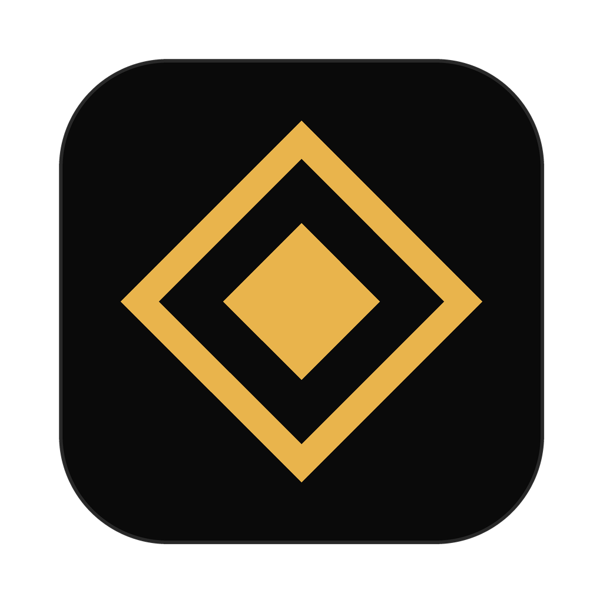

<div align="center">


<br><br>



# Phantom

### The only native Swift macOS Cluely alternative.

*No Electron. No subscription. No cloud. Just Swift.*  
*AI invisible to screen sharing — Zoom, Teams, Meet, OBS.*

<br>

[**Download DMG**](https://github.com/nagasai-2003/Phantom/releases) · [**Build from source**](#install) · [**Report bug**](https://github.com/nagasai-2003/Phantom/issues)

</div>

---

## Why Phantom over Pluely, Natively, or Vysper?

Every other Cluely alternative is built on **Electron or Tauri** — that means a bundled Chromium browser, 200–500MB of RAM just to open, and slow startup times.

Phantom is written in **native Swift using AppKit**. It starts instantly, uses minimal memory, and feels like a real macOS app — because it is one.

| | Phantom | Pluely | Natively | Vysper |
|---|---|---|---|---|
| **Tech** | ✅ Native Swift | Tauri/Rust | Electron | Electron |
| **macOS only** | ✅ Purpose-built | ❌ Cross-platform | ❌ Cross-platform | ❌ Cross-platform |
| **Ollama / local LLMs** | ✅ | ⚠️ Partial | ✅ | ❌ |
| **Free** | ✅ Always | ✅ | ✅ Free tier | ✅ |
| **No subscription** | ✅ | ✅ | ⚠️ Premium tier | ✅ |
| **Open source** | ✅ MIT | ✅ | ✅ | ✅ |
| **No telemetry** | ✅ Zero | ⚠️ | ⚠️ Limited | ❓ |
| **Voice input** | ✅ On-device | ❌ | ✅ | ❌ |
| **App size** | ✅ ~5MB | ~10MB | ~150MB | ~200MB |

---

## What is Phantom?

A macOS menu bar AI client that is **completely invisible to screen capture**.

Zoom, Google Meet, Microsoft Teams, OBS, QuickTime, Cmd+Shift+5 — none of them see it. It only exists on your physical display.

```swift
// The entire secret. One native AppKit API.
window.sharingType = .none
```

No hacks. No injection. A public, documented Apple API that removes the window from the display capture pipeline before any recording tool can touch it.

---

## Use cases

**Technical interviews**  
LeetCode, HackerRank, take-home assessments. Ask for hints, complexity analysis, edge cases — all while sharing your screen. The interviewer sees your code. They don't see Phantom.

**Live coding demos**  
Presenting to a client or team? Use AI to look up syntax, generate boilerplate, or sanity-check logic in real time. Nobody notices.

**Work calls & meetings**  
Prepare answers on the fly. Summarize what was just said. Draft a response before you speak.

**System design interviews**  
Ask for architecture patterns, trade-offs, scalability approaches instantly.

**Local & private**  
Pair with Ollama or LM Studio for fully on-device inference. Nothing leaves your machine.

---

## Tested invisible in ✅

| Tool | Status |
|---|---|
| Zoom | ✅ Invisible |
| Google Meet (Chrome) | ✅ Invisible |
| Microsoft Teams | ✅ Invisible |
| OBS Studio | ✅ Invisible |
| QuickTime screen recording | ✅ Invisible |
| macOS Cmd+Shift+5 | ✅ Invisible |

---

## Features

| | |
|---|---|
| 🫥 **Invisible by default** | Hidden from every screen capture tool on macOS |
| 🍎 **Menu bar only** | No Dock icon. No trace. Appears as **◈** |
| 🤖 **Multi-backend** | Ollama, OpenAI, Claude, OpenRouter, NVIDIA NIM, LM Studio, llama.cpp |
| 🎙 **Voice input** | On-device transcription via whisper-cpp |
| 🎧 **Listen mode** | Live transcript of call audio (the other person). Your mic stays off. |
| 📸 **Screenshot analysis** | Capture your screen → attach to message. Model sees it, recorder doesn't. |
| 🔒 **Zero telemetry** | No analytics, no cloud, no tracking |
| ⚡ **Instant startup** | Native Swift — no Chromium, no Electron overhead |

---

## Install

**Option A — DMG (fastest)**

Download [`Phantom-v1.0.2.dmg`](https://github.com/nagasai-2003/Phantom/releases), drag to Applications, open.

> **Note:** Phantom is not notarized. On first launch, right-click → Open → Open anyway.

**Option B — Build from source**

```bash
# Requirements: macOS 13+, Xcode Command Line Tools
xcode-select --install

git clone https://github.com/nagasai-2003/Phantom.git && cd Phantom
bash build.sh
open Phantom.app
```

The **◈** icon appears in your menu bar. Click → **Open chat**.

---

## How the invisibility works

macOS exposes a window-level API that controls whether a window participates in the display server's capture pipeline:

```swift
NSWindow.sharingType = .none     // excluded from all capture
NSWindow.sharingType = .readOnly // default — visible to recorders
```

Setting `.none` tells the macOS compositor to exclude the window from all capture operations before any recording application, screenshot tool, or API (`CGWindowListCreateImage`, `SCStreamConfiguration`, etc.) can observe it.

The window renders normally on your physical display. It simply does not exist to capture pipelines.

---

## Backends

Open **◈ → Settings…** and pick your backend:

| Backend | URL | Notes |
|---|---|---|
| **Ollama** | `http://localhost:11434` | Local, no key |
| **OpenAI** | `https://api.openai.com/v1` | API key required · 📷 gpt-4o, gpt-4.1, gpt-5 read screenshots |
| **Groq** | `https://api.groq.com/openai/v1` | Free API key · 📷 qwen3.8-27b reads screenshots |
| **Anthropic** | `https://api.anthropic.com/v1` | API key required |
| **OpenRouter** | `https://openrouter.ai/api/v1` | API key required |
| **NVIDIA NIM** | `https://integrate.api.nvidia.com/v1` | Free tier available |
| **LM Studio** | `http://localhost:1234/v1` | Local, no key |
| **llama.cpp** | `http://localhost:8080/v1` | Local, no key |

Any OpenAI-compatible server works — select **OpenAI** and set the URL.

The model list shows chat models only (speech, safety-filter, embedding, image-generation and Arabic-only models are hidden). Models that can read screenshots are marked **📷** and listed first. If you attach a screenshot while a text-only model is selected, Phantom sends that message to a 📷 model and says which one. Each provider keeps its own API key, so switching between Groq and OpenAI keeps both.

### Free models via NVIDIA NIM

1. Go to [build.nvidia.com](https://build.nvidia.com) → sign in → any model → **Get API Key**
2. Key starts with `nvapi-`
3. In Phantom: select **NVIDIA NIM**, paste key

Hundreds of models (Llama, Mistral, Gemma, Qwen, DeepSeek) — no credit card required.

---

## Voice input

```bash
brew install whisper-cpp
curl -L -o /opt/homebrew/share/whisper-cpp/ggml-base.bin \
  https://huggingface.co/ggerganov/whisper.cpp/resolve/main/ggml-base.bin
```

Press **🎙** or **⌘⌥** → speak → press again → transcribed and sent. Fully on-device.

| Model | Size | Quality |
|---|---|---|
| `tiny` | 75 MB | Fast |
| `base` | 150 MB | Balanced ✓ |
| `small` | 470 MB | Better |
| `medium` | 1.5 GB | Best |

---

## Listen mode

Listen mode **starts automatically when the chat opens** (turn this off with ◈ → *Auto-listen when chat opens*). Press **🎧** or **⌃2** to stop or start it. It transcribes what your Mac is playing, such as the other person on a call.

- Uses ScreenCaptureKit to capture system audio only. **The microphone is never opened**, so your own voice is not recorded.
- Speech is transcribed on-device in short chunks and appears in the message box as it is spoken.
- After a clear pause (3 s of silence by default; change it in ◈ → *Auto-send after pause*: 2 s, 3 s, 5 s or Off) the transcript is sent to the AI automatically. Press **⌃4** (or **Enter** in the chat) to send sooner.
- Needs whisper-cpp (see Voice input) and **Screen & System Audio Recording** permission.
- Recording or transcribing other people may need their consent where you live. Check before you use it on a call.

---

## Screenshot analysis

Press the **screenshot button** (next to 🎧) or **⌘⇧** → captures screen → attaches to next message.

The model sees your screen. The screen recorder doesn't see Phantom.

Works with any vision model: `llava`, `gpt-4o`, `gemma3`, `claude-opus-4-7`…

---

## Keyboard shortcuts

| Action | Shortcut |
|---|---|
| Send message | **Enter** |
| New line | **Shift+Enter** |
| Voice input | **⌘⌥** |
| Show / hide chat (any app, even full screen) | **⌃1** (Control + 1) |
| Listen on / off | **⌃2** (Control + 2) or 🎧 |
| Screenshot | **⌃3** (Control + 3), **⌘⇧**, or the screenshot button |
| Answer now | **⌃4** (Control + 4) |
| Close | **Cmd+W** |

All shortcuts customizable in Settings.

---

## Privacy

- **No telemetry.** No analytics. No crash reporting to any server.
- **No cloud.** Network calls go only to your configured backend.
- **Local backends** (Ollama, llama.cpp, LM Studio) run entirely on your machine — nothing leaves it.
- **Voice** transcription runs on-device via Whisper.
- **Screenshots** are sent only to your configured backend.

---

## Contributing

PRs welcome. Open an issue first for large changes.

```bash
git clone https://github.com/nagasai-2003/Phantom.git
cd Phantom
open Package.swift   # Xcode opens automatically
```

---

<div align="center">

Made with ◈ — because some things should stay invisible.

<sub>Phantom is a fork of <a href="https://github.com/rbc33/Ghostbar">Ghostbar</a> by rbc33, used under the MIT License.</sub>

</div>